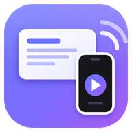

<p align="center"></p>

# SlideLink

**Am PC präsentieren, alles vom Handy aus steuern.** 🇬🇧 [English version](README.md)

SlideLink ist eine Präsentations-App für Windows mit einer Android-Fernbedienung. Sie zeigt Präsentationen aus
[Claude](https://claude.ai) genau so, wie sie dort aussehen (Claude-Slides-Decks, HTML-Seiten und Claude Docs),
hält PC und Handy live synchron und lässt Claude Präsentationen direkt in der App erstellen.

 

## Funktionen

**Am PC**
- Bibliothek wie ein Spiele-Launcher: Reiter *Präsentationen* und *Docs*, neueste zuerst, nach Tagen gruppiert
- Präsentationsmodus mit Klick-Animationen (Builds), Animationen und Übergängen, genau wie auf claude.ai
- Randloses Vollbild-Präsentationsfenster (Esc schließt es)
- Überwacht den Ordner `Claude Presentations`: Alles, was Claude dort speichert, erscheint automatisch
- Hochladen: PowerPoint (wird von PowerPoint umgewandelt), claude.ai-Deck als `.zip`, HTML, PDF-Docs, Bilder
- Editor mit Live-Sync sowie ein MCP-Server, damit Claude Folien erstellen und bearbeiten kann, während du zusiehst
- Tray-App (wie Steam): läuft im Hintergrund, optional Start mit Windows, läuft nur einmal

**Auf dem Handy (Android-App)**
- Fernbedienung mit aktueller Folie, nächster Folie, Sprechernotizen, Timer, Blackout, Build-Punkten
- Folien und Präsentationen wechseln, „Show on PC“ / „Close window on PC“
- Lautstärketasten: **+** weiter, **−** zurück
- Verbindet sich selbst: im Heim-WLAN direkt und verschlüsselt, wenn Handy und PC im selben Netz sind, sonst über das SlideLink-Relay
- Akkuschonend: standardmäßig Standbild-Vorschau, 12 fps im Live-Modus, dimmt beim Präsentieren, pausiert im Hintergrund
- Aktualisiert sich selbst über deinen PC

## Neu in 1.4.1
- Nach einem Netzwechsel (z. B. WLAN -> Mobilfunk) erscheint ein Handy nicht mehr doppelt: Seine alte Verbindung wird sofort entfernt.

## Neu in 1.4.0: Ende-zu-Ende-Verschlüsselung
- **Ende-zu-Ende verschlüsselt über das Relay:** Zwischen der SlideLink-App und deinem PC ist alles verschlüsselt (Folien, Notizen, Befehle, Anmeldung), sodass selbst das Relay nichts lesen oder verändern kann. Beim Koppeln zeigen Handy und PC eine 6-stellige Zahl, wie bei Bluetooth; am PC bestätigst du, dass sie gleich ist.
- **Kein unverschlüsseltes http mehr für Handys:** Port 8765 hört nur noch auf den PC selbst; Handys nutzen die verschlüsselte WLAN-Adresse oder das Relay.
- Android-App 1.17 (bereits verknüpfte Handys werden gefragt, ob sie Ende-zu-Ende neu verknüpfen wollen). Zuschauer und Gruppenmitglieder im Browser behalten die normale HTTPS-Verbindung zum Relay.
- Unter der Haube: aufgeräumte Styles, Übersetzungen, die Icons überstehen, mit Prüfung auf Lücken, Releases mit einem Befehl (`release.ps1`), automatische Tests (`tests/`).

## Neu in 1.3.3: neues Desktop-Design
- Die Desktop-App bekommt dieselbe ruhige Optik und die eigenen SlideLink-Icons wie das Handy.

## Neu in 1.3.2: neues Handy-Design, signierte Updates
- **Neues Handy-Design:** ruhigere, aufgeräumte Fernbedienung mit eigenen SlideLink-Icons (App 1.15).
- **Handy-App aktualisiert sich über den PC:** SlideLink holt die neueste Android-App von GitHub und bietet sie jedem verbundenen Handy an.
- **Signierte Updates:** Desktop- und App-Updates werden nur installiert, wenn sie die Release-Signatur von SlideLink tragen (RSA-3072). Zugriff auf das GitHub-Konto allein reicht also nicht, um Software auf deinen PC zu bringen.

## Beta 1.3.0: funktioniert überall, ohne Tailscale
- **SlideLink-Relay:** Handys und Publikum erreichen deinen PC aus jedem Netz (Mobilfunk, Schule, Hotel), ohne Einrichtung und ohne Zusatz-App. Der PC hält eine ausgehende Verbindung zum Relay (ein Cloudflare Worker, `relay/worker`), Router und Firewalls spielen deshalb keine Rolle. Beim Beenden von SlideLink endet sie.
- **Verschlüsseltes Heim-WLAN:** Der PC erzeugt sein eigenes HTTPS-Zertifikat (Port 8766); die Android-App vertraut genau diesem Zertifikat.
- **Sicherheit:** Schutz gegen DNS-Rebinding, Importe nur noch über die SlideLink-Chrome-Erweiterung, Logins verschiedener PCs im Relay getrennt (mit Rückfrage, bevor ein Link zu einem anderen PC wechselt), Anfrage-Grenzen pro Adresse.
- **Automatische Updates:** SlideLink installiert jede neue stabile Version selbst (nie Betas, nie während einer Präsentation).
- Android-App 1.14. Tailscale wird nicht mehr verwendet.

## Beta 1.2.1: Sprachen, Anzeige, Einstellungen
- **Sprachen:** Englisch und Deutsch. Der Admin wählt die Sprache am PC (⚙ Einstellungen), und jeder Bildschirm folgt ihr live: PC, Handys, Mitvortragende, Publikum und die Android-App. Gäste können ihre eigene wählen.
- **Anzeige:** hell, dunkel oder wie das System, pro Gerät (⚙ Einstellungen).
- **Einstellungen** hinter einem Zahnrad oben in der Bibliothek, auch am Handy erreichbar (🔗 Verknüpfte Geräte).
- **Bibliothek:** „＋ Präsentation hinzufügen“ (PowerPoint, Deck-.zip, HTML, PDF-Doc, Bilder) ersetzt „Neue Präsentation“; jede Kachel hat ein ⋯-Menü (Titel und Sprechernotizen bearbeiten, duplizieren, löschen); der Sync-Status ist ein kleines Abzeichen am Ordner-Knopf.
- **Neues Logo** in hoher Auflösung; Verknüpfte Geräte hat jetzt ein 🔗-Ketten-Symbol.

## Neu in 1.1.0: Publikum, Live-Umfragen, Präsentieren in der Gruppe
- **Publikums-Link** (`/live?k=…`): Zuschauer scannen einen QR-Code (auch groß auf der Leinwand) und sehen die aktuelle Folie live im Browser ihres Handys. Nur ansehen: keine Steuerung, keine Sprechernotizen. *New link* macht den alten Link ungültig.
- **Live-Umfragen:** Am Handy (👥 Live) eine Umfrage mit 2-4 Antworten starten. Das Publikum stimmt auf der Publikumsseite ab (eine Stimme pro Handy); das Ergebnis lässt sich live als Balken auf der Leinwand zeigen.
- **Present in group:** Gruppen-Sitzung am PC oder Admin-Handy starten. Mitvortragende scannen einen QR-Code und treten mit ihrem Namen bei, im Browser (auch iPhone) oder in der Android-App. Sie steuern nur den Vortrag (Folien, Umfragen, Notizen, *I'm presenting*), bearbeiten oder wechseln nie Präsentationen und fliegen raus, wenn die Sitzung endet (*End group session* am PC oder Admin-Handy, oder automatisch nach 4 Stunden). Nichts bleibt verknüpft.

## Installation

### Windows
1. **`SlideLink-Setup.exe`** aus den [Releases](../../releases) herunterladen.
2. Starten. SlideLink wird für deinen Benutzer installiert (keine Admin-Rechte nötig). Fehlt Python 3.10+, bietet das
   Setup an, es zu installieren. Windows SmartScreen kann warnen, weil die EXE nicht signiert ist: *Weitere Informationen → Trotzdem ausführen*.
3. SlideLink öffnet sich und läuft im Infobereich (unten rechts) weiter.

Stille Installation: `SlideLink-Setup.exe /S [/Launch] [/Startup] [/NoDesktop]`.

### Android
1. Am PC **⚙ Linked devices** öffnen. Ist noch kein Handy verbunden, erscheint ein **QR-Code**: mit der Handy-Kamera
   scannen und die App herunterladen (oder `SlideLink.apk` aus den Releases laden).
2. Installieren (Android fragt, ob Installationen aus dieser Quelle erlaubt sind; Play Protect kann warnen, weil die
   App nicht aus dem Play Store kommt: *Weitere Details → Trotzdem installieren*).
3. App öffnen, die in SlideLink angezeigte PC-Adresse eingeben und dann den 6-stelligen Code aus **Link a new device** eintippen.

### Den PC von überall erreichen
Eingebaut: Zu Hause spricht das Handy verschlüsselt über WLAN mit dem PC, überall sonst über das SlideLink-Relay.
Nichts zu installieren oder einzurichten. Für ein eigenes Relay `relay/worker` veröffentlichen (`npx wrangler deploy`)
und seine Adresse in der Umgebungsvariable `SLIDELINK_RELAY` eintragen; `off` schaltet das Relay ab.

## Voraussetzungen
- Windows 10/11, Python 3.10+ (nur Standardbibliothek), Google Chrome oder Microsoft Edge
- Android 8.0+ für die App
- Optional: PowerPoint (für `.pptx`-Import)

## Dokumentation
| | Deutsch | English |
|---|---|---|
| Desktop-App & Server (Python, Web-Oberfläche, API) | [docs/desktop.de.md](docs/desktop.de.md) | [docs/desktop.md](docs/desktop.md) |
| Android-App (Java) | [docs/android.de.md](docs/android.de.md) | [docs/android.md](docs/android.md) |

## Projektstruktur
```
server.py            HTTP-Server: Bibliothek, Live-Sync (SSE), Geräte, Importe, Ordnerüberwachung
SlideLink.pyw        Windows-Desktop-App: Tray-Symbol, App-/Präsentationsfenster, nur eine Instanz
mcp_server.py        MCP-Server: Claude kann Präsentationen auflisten, erstellen und steuern
static/              Web-Oberfläche: Bibliothek, Editor, Präsentation, Handy-Fernbedienung (reines JS, kein Build)
android/             Android-App (Java, ohne Gradle) + Build-Skript
setup/               Windows-Installer (C#, kompiliert mit dem in Windows enthaltenen C#-Compiler)
chrome-extension/    Optional: Decks aus claude.ai in Chrome importieren
relay/               SlideLink-Relay: Cloudflare Worker (worker/) und eine lokale Testversion (relay.py)
install.ps1 / uninstall.ps1, updater.py, wsmini.py, make_cert.ps1, pdf_pages.ps1, save_deck.py, save_doc.py, import_claude_deck.py, make_icon.py
```

## Sicherheit
Nur Geräte, die du mit einem einmaligen 6-stelligen Code verknüpfst (10 Minuten gültig, nach 8 Fehlversuchen
ungültig), können etwas sehen oder steuern. Geräte-Tokens werden nur als SHA-256-Hash gespeichert. Anfragen über
das Relay oder einen Proxy gelten nie als der PC selbst, und nur die eigenen lokalen Namen des PCs zählen als PC (kein DNS-Rebinding). Siehe [docs/desktop.de.md](docs/desktop.de.md#sicherheit).

## Lizenz
[MIT](LICENSE)
