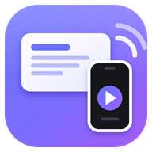

<p align="center"></p>

# SlideLink

**Present from your PC, control everything from your phone.** 🇩🇪 [Deutsche Version](README.de.md)

SlideLink is a presentation app for Windows with an Android remote. It shows presentations made with
[Claude](https://claude.ai) exactly as they look there (Claude Slides decks, HTML pages and Claude Docs),
keeps PC and phone in sync live, and lets Claude build presentations directly in the app.

 

## Features

**On the PC**
- Library like a game launcher: *Presentations* and *Docs* tabs, newest first, grouped by day
- Presenter with click builds, animations and transitions, exactly like claude.ai
- Borderless fullscreen presentation window (Esc closes it)
- Watches the folder `Claude Presentations`: everything Claude saves there appears automatically
- Upload: PowerPoint (converted by PowerPoint), claude.ai deck `.zip`, HTML, PDF docs, images
- Editor with live sync, plus an MCP server so Claude can build and edit slides while you watch
- Tray app (like Steam): runs in the background, optional start with Windows, runs only once

**On the phone (Android app)**
- Remote with live slide, next slide, speaker notes, timer, blackout, build dots
- Switch slides and presentations, "Show on PC" / "Close window on PC"
- Volume keys: **+** next, **−** back
- Connects by itself: encrypted home Wi-Fi when on the same network as the PC, the SlideLink Relay everywhere else
- Battery friendly: still preview by default, 12 fps when live, dims while presenting, pauses in the background
- Updates itself from your PC

## New in 1.4.1
- After switching networks (e.g. Wi-Fi -> mobile data) a phone no longer shows up twice: its old connection is dropped at once.

## New in 1.4.0: end-to-end encryption
- **End-to-end encrypted through the relay:** between the SlideLink app and your PC everything is encrypted (slides, notes, commands, login), so even the relay can't read or change it. Pairing shows a 6-digit number on the phone and the PC, like Bluetooth; you confirm on the PC that they match.
- **No plain http for phones:** port 8765 only listens on the PC itself; phones use the encrypted Wi-Fi address or the relay.
- Android app 1.17 (already linked phones are offered to link again end-to-end). Audience and group members in a browser keep the normal HTTPS connection to the relay.
- Under the hood: tidier styles, translations that survive icons and a check for missing ones, one-command releases (`release.ps1`), automatic tests (`tests/`).

## New in 1.3.3: new desktop design
- The desktop app gets the same calm look and SlideLink's own icons as the phone.

## New in 1.3.2: new phone design, signed updates
- **New phone design:** calmer, cleaner remote with SlideLink's own icons (app 1.15).
- **Phone app updates itself through the PC:** SlideLink pulls the newest Android app from GitHub and offers it to every connected phone.
- **Signed updates:** desktop and phone-app updates are only installed if they carry SlideLink's release signature (RSA-3072), so access to the GitHub account alone can't push software onto your PC.

## Beta 1.3.0: works everywhere, no Tailscale
- **SlideLink Relay:** phones and the audience reach your PC from any network (mobile data, school, hotel), with nothing to set up and no extra app. The PC keeps one outgoing connection to the relay (a Cloudflare Worker, `relay/worker`), so routers and firewalls don't matter. Closing SlideLink closes it.
- **Encrypted home Wi-Fi:** the PC creates its own HTTPS certificate (port 8766); the Android app trusts exactly this certificate.
- **Security:** protection against DNS rebinding, imports only from the SlideLink Chrome extension, logins of different PCs separated on the relay (with a warning before a link switches to another PC), request limits per address.
- **Automatic updates:** SlideLink installs every new stable version by itself (never betas, never during a presentation).
- Android app 1.14. Tailscale is no longer used.

## Beta 1.2.1: languages, appearance, settings
- **Languages:** English and German. The admin picks the language on the PC (⚙ Settings) and every screen follows it live: PC, phones, co-presenters, audience and the Android app. Guests can choose their own.
- **Appearance:** light, dark or like the system, per device (⚙ Settings).
- **Settings** behind a gear at the top of the library, also reachable on the phone (🔗 Linked devices).
- **Library:** "＋ Add presentation" (PowerPoint, deck .zip, HTML, PDF doc, pictures) replaces "New presentation"; every tile has a ⋯ menu (edit title and speaker notes, duplicate, delete); the sync state is a small badge on the folder button.
- **New logo** in high resolution; Linked devices now uses a 🔗 chain icon.

## New in 1.1.0: audience, live polls, present in group
- **Audience link** (`/live?k=…`): viewers scan a QR code (also shown big on the presentation screen) and follow the current slide live on their phone, in the browser. Watch only: no control, no speaker notes. *New link* invalidates the old one.
- **Live polls:** start a poll with 2-4 answers from the phone remote (👥 Live). The audience votes on the audience page (one vote per phone); results can be shown live as bars on the presentation screen.
- **Present in group:** start a group session on the PC or your admin phone. Co-presenters scan a QR code and join with their name, in the browser (also iPhone) or the Android app. They control the talk only (slides, polls, notes, *I'm presenting*), never edit or switch presentations, and are disconnected when the session ends (*End group session* on PC or admin phone, or automatically after 4 hours). Nothing stays linked.

## Install

### Windows
1. Download **`SlideLink-Setup.exe`** from the [Releases](../../releases).
2. Run it. It installs SlideLink for your user (no admin rights). If Python 3.10+ is missing, the setup offers to install it.
   Windows SmartScreen may warn because the EXE is not signed: *More info → Run anyway*.
3. SlideLink opens. It lives in the tray (bottom right) while running.

Silent install: `SlideLink-Setup.exe /S [/Launch] [/Startup] [/NoDesktop]`.

### Android
1. On the PC, open **⚙ Linked devices**. With no phone connected yet, a **QR code** appears: scan it with the phone camera
   to download the app (or download `SlideLink.apk` from the Releases).
2. Install it (Android asks to allow installs from this source; Play Protect may warn because the app is not from
   the Play Store: *More details → Install anyway*).
3. Open the app, enter the PC address shown in SlideLink, then type the 6-digit link code from **Link a new device**.

### Reaching the PC from anywhere
Built in: at home the phone talks to the PC over encrypted Wi-Fi, everywhere else through the SlideLink Relay.
Nothing to install or set up. To use your own relay, deploy `relay/worker` (`npx wrangler deploy`) and set its
address in the environment variable `SLIDELINK_RELAY`; `off` switches the relay off.

## Requirements
- Windows 10/11, Python 3.10+ (standard library only), Google Chrome or Microsoft Edge
- Android 8.0+ for the app
- Optional: PowerPoint (for `.pptx` import)

## Documentation
| | English | Deutsch |
|---|---|---|
| Desktop app & server (Python, web UI, API) | [docs/desktop.md](docs/desktop.md) | [docs/desktop.de.md](docs/desktop.de.md) |
| Android app (Java) | [docs/android.md](docs/android.md) | [docs/android.de.md](docs/android.de.md) |

## Project layout
```
server.py            HTTP server: web UI, API, live sync (SSE)
core.py              shared paths, constants and helpers
importers.py         imports: Claude decks, HTML, zip, JSON, images, PowerPoint, PDF
devices.py           linked devices and the phone app files
network.py           relay client, HTTPS for Wi-Fi, local addresses
decks.py             library, live presentation state, end-to-end pairing
watch.py             watched folder "Claude Presentations"
SlideLink.pyw        Windows desktop app: tray icon, app/presenter windows, single instance
mcp_server.py        MCP server: lets Claude list, build and control presentations
static/              Web UI: library, editor, presenter, phone remote (plain JS, no build step)
android/             Android app (Java, no Gradle) + build script
setup/               Windows installer (C#, compiled with the C# compiler built into Windows)
chrome-extension/    Optional: import decks from claude.ai in Chrome
relay/               SlideLink Relay: the Cloudflare Worker (worker/)
install.ps1 / uninstall.ps1, updater.py, wsmini.py, make_cert.ps1, pdf_pages.ps1, save_deck.py, save_doc.py, import_claude_deck.py, make_icon.py
```

## Security
Only devices you link with a one-time 6-digit code (valid 10 minutes, destroyed after 8 wrong tries) can see or
control anything. Device tokens are stored only as SHA-256 hashes. Requests through the relay or any proxy are
never treated as the PC itself, and only the PC's own local names count as the PC (no DNS rebinding). See [docs/desktop.md](docs/desktop.md#security).

## License
[MIT](LICENSE)
